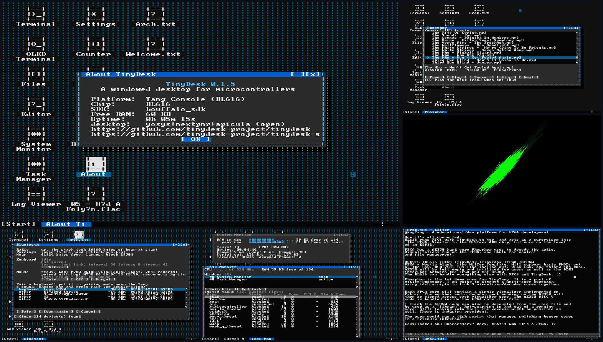
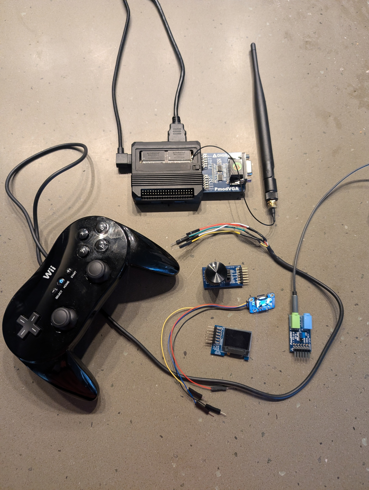

# TinyTang





A Tang Console 138K with a real desktop on it: **TinyDesk Shell** and the
**TinyDesk** desktop running on the board's BL616, shown on the board's own
HDMI output, driven by a Bluetooth keyboard and mouse, with the SD card
as the filesystem and the FPGA booting cores on command. F12 switches the
screen between TinyDesk and whatever core is running, the way MiSTer's menu
key does.

The BL616 does the computing and the FPGA does the display. TinyDesk renders
ANSI as it always does; on the board that stream goes through a terminal
emulator into an 80x45 text layer the FPGA composites over its video, so the
HDMI output shows the desktop. The same stream also goes down the USB CDC, so a
terminal on a computer can show and drive the same session.

TinyTang stands on nand2mario's work. Its lineage runs through his TangCore
firmware for this same BL616 (`firmware-bl616`), by way of Tang-Control, a fork
of it: the board knowledge TinyTang rests on was learned there, its Gowin JTAG
programmer is his, the UART protocol between the BL616 and the FPGA cores is his
design, and the desktop core began as his nestang. What was written for TinyTang
is the rest -- the TinyDesk Shell port, the desktop on HDMI, Bluetooth input,
the crash recorder -- and `THIRD_PARTY.md` says exactly what came from where.
For a dedicated game launcher with his full library of cores, see
[TangCore](https://github.com/nand2mario/tangcore).

## As a TinyDesk Shell port

TinyTang is a port of TinyDesk Shell, with TinyDesk, to the BL616.

- **Platform:** `bl616/freertos`, on the Sipeed Tang Console 138K.
- **Built against:** TinyDesk Shell at upstream `main` (`a067fa7`), ahead of the
  0.1.6 release because that is where `peek`/`poke` and the configurable limits
  live, and TinyDesk 0.1.5 at its `v0.1.5` tag. For a build against v0.1.5 the
  shell still needs the carried patch `THIRD_PARTY.md` lists; with this pin the
  script finds the change already present and applies nothing.
- **Prefix:** `tang` -- `tang_` in C, `TANG_` in macros, and commands such as
  `tangload`, `tangput` and `tangflash`.
- **Adds:** the desktop drawn over HDMI by the FPGA core and mirrored over USB
  CDC; a Bluetooth LE keyboard and mouse; loading FPGA cores and ROMs from the
  SD card; music through the Tang-Phosphor core; firmware self-update; a crash
  recorder.
- **Leaves out or changes:** no networking (the BL616's Wi-Fi is not used);
  script workers get a 16 KB stack instead of 32 KB, and each session holds
  at most 48 variables with names of up to 31 bytes and values of up to
  127 bytes, to fit the heap (tinydesk-project/tinydesk-shell issue #2).
  The build sets the same limits for all shell, desktop and port sources.
- **Licence:** MIT, with thirteen Apache-2.0 files listed in `THIRD_PARTY.md`.

Building and flashing are under *Quick start* and *Building requirements*.

## What it does

- **Boots to a console on HDMI and configured VGA.** `/root/scripts/boot.tdsh` loads
  `tinytang.bin`, turns the desktop layer on, and stops at the shell prompt
  (`root@tinytang:~#`) drawn on the screen. The board has the shell's built-in
  commands, redirection and scripts, plus the Tang commands below.
- **`desktop`** runs TinyDesk on that console: overlapping draggable text-mode
  windows, a taskbar and a start menu, with Terminal, Files, Editor, System
  Monitor, Task Manager, Log, Settings, Counter, Phosphor and About. Quitting returns to
  the prompt. Opening a text file (double-click or Enter) shows it in the
  Editor, and `.tdsh` scripts open there and run from their menu; a `.nes`
  cartridge is not opened at all, because cartridges start from the TinyNES
  app's Library. The network apps (Network, MQTT, Modbus, OTA) are left out because
  they are built on POSIX sockets and mbedTLS. In their place, Settings'
  **Bluetooth...** button opens a Bluetooth window showing the radio, the heap,
  and the keyboard, mouse and combo slots with their connection state and
  latest event. Each slot pairs from an 8-second scan (its own kind listed
  first), turns reconnecting off and on, and forgets its pairing, asking first
  before letting go of a connected device; the work runs on the Bluetooth
  task, so the desktop never waits, and a `blekbd`, `blemouse`, `blecombo` or
  `blescan` started while the
  window is busy is refused rather than queued. A scan that would start the
  radio needs 32 KB of heap free. The button is TinyTang's, from the carried patch
  `third_party/patches/tinydesk/0001-settings-bluetooth-button.patch`.
- **The Terminal window runs the shell.** It is the same session as the
  console, reached through a bridge over two ring buffers, so a command typed
  into a desktop window runs as it would at the console. One user and one
  session by design.
- **F12 switches between TinyDesk and the core.** It flips the overlay: the
  core keeps running underneath, and while TinyDesk is up the controllers are
  gated away from the game. It works at the console, in the desktop and during
  a game. L on controller 1 does the same on the NES core. On the desktop core
  the core's side is an empty frame; on the NES core it is the game.
- **A keyboard.** A Bluetooth LE keyboard connected with `blekbd` types at
  the console and in the desktop; the BL616 receives it directly, so it works
  on any core that carries the desktop layer. The BL616 turns its reports into
  the bytes an ANSI terminal sends, with auto-repeat generated on the board.
  Function keys are not translated yet, so the desktop's F10 (start menu), F6
  (switch windows) and F11 (full screen) work from a computer's terminal but
  not from the keyboard; F12 is reserved for switching the screen and is never
  typed.
- **A pointer in the desktop.** A Bluetooth LE mouse connected with
  `blemouse`, the D-pad on controller 1, or the arrows with left-alt held,
  moves it; the mouse's buttons, A or Enter are the left button, B or Esc the
  right, and holding the left button while moving drags. The mouse's middle
  button and wheel are passed on too. All of them drive the same pointer. The pointer exists only while
  the desktop runs: at the bare console it is not drawn and does not move,
  and the mouse is the shell's instead (next bullet).
- **The mouse at the console prompt.** With the desktop not running the wheel
  scrolls the shell's own history -- one detent is one Up or Down, so wheel up
  once recalls the last command -- and a left click presses Enter on the line
  as it stands, recalled or typed. So `desktop` is two gestures away: wheel up
  once, click. Both are only sent while the shell is waiting at its prompt;
  while a command runs the mouse is ignored and a press is not saved for
  later. The history is the shell's, kept in `~/.tdsh_history` on the card, so
  the first command has to be typed once before the wheel has anything to
  recall.
- **The SD card** mounted read/write over FatFS, so `ls`, `cat`, `echo >`,
  `rm`, `mkdir`, `cp`, `mv` all work on the card. FatFS is built reentrant
  (`FF_FS_REENTRANT`), so the shell, the desktop and the playback task can use
  the card at the same time.
- **`tangload <path>`** programs the FPGA with a core image from the SD over
  the board's JTAG. A core loads in a second or two.
- **`fpga`** asks the running core for its ID over the BL616's UART link: the
  link's liveness proof. This project's cores answer 1; the core the FPGA comes
  up with on its own answers 0.
- **`nesload <path>`** streams an iNES ROM into the NES core and starts it.
- **`fpgapipe`** passes the console straight through to the core's UART and
  back, unframed and untranslated, until the host closes the port (DTR
  drops). It is how a core that speaks its own protocol on the link is driven
  from the host in two-wire mode: TinyNES's `tools/load_ae350.py --tinytang`
  loads AE350 programs through it at the link's 2 Mbaud line rate.
- **`ae350run <program.elf> [<file>]`** loads a program from the card into a
  TinyNES core's AE350, through its boot ROM's load protocol (8 KiB blocks
  with CRC-32s, resent when refused), sends `<file>` when the program asks
  with a `TinyNES WANT` line, prints the program's output and returns its exit
  code at `TinyNES EXIT`. A program that prints `TinyNES LINK` has turned the
  core's UART to the frame protocol: `ae350run` then gives the link back to
  the desk layer, so HOME on the controller or F12 shows TinyDesk over the
  running game, and reads the program's text from `0x20` frames. TinyNES's
  `.nes` launcher uses it to play a cartridge from the card with no PC
  attached. The protocol code,
  `ae350_load.c`, has a host test, `tools/tests/test_ae350_load.sh`.
- **`peek` / `poke`** read and write the memory the port lists, root only: the
  BL616's RAM read/write, and the XIP flash, system control and trustzone
  registers read-only. `peek -l` prints the regions and
  `tools/tinytang_memdump.py` dumps one to a file. Nothing else is reachable: a
  read at `0x90000000` or above, where the mask ROM sits, resets the board into
  its loader in about 23 ms, with no exception, no crash record and nothing the
  running firmware can read afterwards.
- **`phosphor caps | peek | poke | play | pause | resume | status | stop | run | stats`**
  drives a loaded
  Tang-Phosphor core over its extended protocol (register access on frame
  type `0x10`, files streamed on `0x11` at 5 Mbaud). `phosphor play <file>`
  plays any of the twelve formats Phosphor supports -- WAV, FLAC, MP2, MP3,
  Ogg Vorbis, Opus, AAC, ALAC, WavPack, WMA, AC-3 and TTA -- by loading the
  resident Rockbox player `/root/ae350/tinyphosphor-play.tpi` onto the core's AE350 and
  serving the file to it on demand, as the player asks for each part, so a
  track starts as soon as the player is sent. A playback task owns the
  track, so the shell is
  free: `nowait` returns at once and the track plays in the background, while
  plain `play` waits for it and Ctrl-C stops the track itself, not just the
  wait. `phosphor status` shows the state (idle, loading, playing, ended,
  stopped, failed), the file, elapsed time, samples, rate and underruns;
  `phosphor pause` holds the track where it is (even while it is still
  loading) and `phosphor resume` carries on, without the pause counting as a
  stall; `phosphor stop` silences the track at once and restarts the AE350. A new
  `play` replaces the current track, and `tangload` stops it before it
  reprograms the FPGA. `phosphor run <image.tpi> [file]` loads any AE350
  program and serves the byte ranges of `file` that it requests through its
  result-word mailbox (Tang-Phosphor `ae350_request.h`), printing each request
  with its CRC and then the program's result words. The core,
  `/root/cores/console138k/tinyphosphor.bin`, carries the desktop layer, so it
  runs under TinyDesk with the layer left on. The merged core has no WAV or FLAC decoder in the
  fabric: its FPGA player is a raw-PCM sink fed by the AE350, so the AE350 is
  the only way to play a file. `scripts/tinyphosphor.tdsh` loads the core with the
  desktop up, probes it, enables the stereo XY oscilloscope with medium trails
  and glow, and hands it the screen, with the PMOD sockets as `/tinytang.ini`
  declares them. Press F12 to return to TinyDesk and choose a track in the
  Phosphor app. Setting `FILE` in the session before running the script starts
  that track without waiting; no default music file is required. F12 switches
  between the oscilloscope and TinyDesk during playback and after it ends.
  This is the single Phosphor launcher: the canonical `tinyphosphor.bin` is
  the qualified TinyPhosphor image (register ABI 1.12) with audio and the
  oscilloscope. The
  earlier `oscope.tdsh`, `i2s2-play.tdsh` and `i2s2-tone.tdsh` scripts are
  retained under `/root/scripts/diagnostics/` on the card for earlier bring-up work
  and are not the normal launch path; their fixed declarations predate
  `/tinytang.ini`.
- **The TinyHelp app** in the desktop's start menu reads the board's manual from
  `/root/manual`: `index.md` lists the chapters as `- [Title](file.md)` and
  each chapter is a Markdown file shown one line per desktop row. It has a
  Contents page, coloured headings, and nothing is held but one chapter at a
  time, so a chapter of any size costs a few kilobytes. It exists because the
  editor's buffer is 16 KB and a manual outgrows it, and because a reader can
  have a contents page where an editor cannot.
- **The Phosphor app** in the desktop's start menu is a player for `/root/media/music`,
  with two tabs. **Player** holds a sorted list of the playable files, the
  title and status of the current track, a progress bar (WAV and FLAC, whose
  length is read from the file's header; the others show elapsed time only),
  Prev, Play, Pause/Resume, Stop, Next, an auto-advance checkbox that plays the
  folder through, and **Load**, which programs `tinyphosphor.bin` without the
  shell: a `tdsh run` from the desktop runs in a worker task and needs the
  script's line table, and with the desktop's heap spent that failed with
  "not enough memory to load the script" and no other sign. **Scope** holds the
  XY scope's controls: enable, **Persistence (Afterglow)** in four durations
  (67, 133, 267 and 533 ms), **Swap X/Y**, **Dots** for points instead of
  joined pairs, **Channels** for the stereo XY or either channel alone, and
  **Bloom** for a pale fringe around the trace. Every setting is read back from
  the core, so the page shows what the FPGA actually took, and the status line
  carries the scope's own state with the sweep and dropped-sample counters. It drives the same playback task as the `phosphor` command, so
  closing the window leaves the track playing and reopening it picks the track
  back up. Without the Phosphor core loaded it says so and its buttons are
  disabled.
- **`/tinytang.ini` names the PMOD layout.** PMOD modules cannot be detected,
  so a core with the sockets (the Phosphor core at register ABI 1.8 or later,
  and the desktop core) drives only what the file says is seated.  Two layouts
  are supported, each module in a fixed socket and seated right side up, with
  nothing flipped or swapped: `layout = i2s2_oled` is the Pmod I2S2 in PMOD1,
  beside the HDMI port, and the Pmod OLEDrgb in PMOD0, beside the USB-A ports;
  `layout = vga` is the PmodVGA across both, J1 in PMOD1 and J2 in PMOD0.
  `docs/tinytang.ini` is a commented example.  Each core is sent the layout as the
  socket word it can take: Phosphor gets `0x0510` or `0x0230`, and the desktop
  core, which has no I2S2, gets the OLED alone (`0x0010`) for `i2s2_oled` and
  `0x0230` for `vga`.  `tangload` sends it after every core load, whichever
  way the core arrives, and leaves cores without sockets alone.  No file, or
  no layout line, leaves both sockets released; so do an unknown layout and
  the old `pmod0`, `pmod1`, `pmod0_flip` and `pmod1_flip` keys, which are
  refused with a line saying what to write instead.  Unknown keys and sections
  are reported and ignored.  `tangini` shows the layout, its problems, the word
  and what the loaded core holds, and `tangini apply` sends it again without
  reloading the core.
- **`tangi2c scan | read | write | rtc | mux | auto`** drives the desktop core's
  I2C bus on the USB-A port (desktop ABI 1.5): SDA on D+ and SCL on D- of the
  populated port, 100 kHz, register-addressed transfers of 1 to 8 bytes, and
  no pull-ups from the FPGA beyond its weak internal ones, so the bus takes its
  pull-ups from Adafruit's Wii Nunchuck Breakout Adapter on that port.  A TI
  PCA9548A switch at 0x70 now sits in front of the devices, one channel live at
  a time; it is a switch and not a second master, so every transfer still comes
  from the loaded core.  The firmware routes the two devices it knows without
  being told — the Wii controller's 0x52 on channel 0 and the DS3231 RTC's 0x68
  on channel 6 — and names channel 7 for the MLX90614 IR thermometer fitted
  there, which answers its address but returns no register data yet, so nothing
  reads it; channels 1 to 5 are unassigned.  `tangi2c mux <0-7>` selects any channel, `tangi2c
  mux off` releases them all and `tangi2c mux` reports the switch and where it
  sits; on a direct bus with no switch the same firmware talks as it always
  did.  The DS3231 on channel 6 holds the desktop clock, so the clock reads and
  sets it through the switch, and a game core is handed channel 0 before it is
  loaded so its controller still answers.  `tangi2c scan` walks all eight
  channels and names what each holds, still finding the DS3231 and not the Wii
  controller; `tangi2c read 0x52 0xfa 6` reaches the controller after its
  wake-up writes (0x55 to 0xf0, then 0x00 to 0xfb).  The engine waits out a
  device that stretches the clock, as the controller does, and reads with a
  STOP and a 200 us pause before the read rather than a repeated START, which
  the controller answers with 0xff.  `tangi2c rtc` reads the DS3231 and prints
  the desktop clock in UTC and local time; `tangi2c rtc set YYYY-MM-DD HH:MM:SS`
  sets the RTC in UTC and `tangi2c rtc sync` rereads it.  `tangi2c auto` is
  refused while the switch is fitted, because the engine's once-a-second read
  cannot select a channel.
- **The desktop clock** is the DS3231's UTC, read when the desktop core is
  loaded and about hourly after that (`ports/bl616/tang_clock.c`), shown in
  the zone the Date & time window keeps in `/tinydesk_tz`. Root can set the
  time from that window, which writes the RTC. With no RTC ever read the clock
  says it is not set rather than invent a date.
- **`osd desk on | off | status`** controls the desktop layer directly. `on`
  shows the console on the layer, `off` stops it and hands the screen back to
  the core, `status` reports cells and rows sent and any refused.
- **`osd on | off | clear | at | menu`** draw on nestang's own 32x28 text
  page, the one nand2mario's menu uses, on a core that has it.
- **`blescan [seconds]`** starts the BL616's own Bluetooth LE radio and lists
  the devices advertising nearby, strongest first, with address, address type,
  signal (dBm), kind (`kbd` or `mouse` from the advertised appearance, `hid`
  for the HID service alone) and name. The radio starts at boot when a device
  is paired, otherwise on the first Bluetooth command, and stays up until
  reset.
- **`blekbd pair [name]`** pairs a Bluetooth LE keyboard (HID over GATT) as an
  input: it listens for 8 s, picks the strongest device advertising as a
  keyboard (or whose name contains `name`), pairs with Just Works and switches
  it to boot protocol, the 8-byte HID boot report. The keyboard types at the
  console and in the desktop, with F12 and left-alt pointer mode (see *A
  keyboard* above).
  **The pairing is saved to the card** (`/sd/root/ble/bonds.bin`), so after a
  reset, or when the keyboard wanders out of range and back, it reconnects by
  itself as soon as it is woken; pairing mode is needed only the first time.
  `blekbd off` and `blekbd on` stop and resume reconnecting, `blekbd forget`
  deletes the pairing, `blekbd watch [seconds]` prints the reports,
  `blekbd <address> [pub|rand] [seconds]` pairs a given address, and `blekbd`
  alone reports the state. Proven with a Logitech K950 (from the MK955 set) in
  Bluetooth mode. Only Bluetooth LE devices work: the SDK has no Bluetooth
  Classic HID host. The keys are stored unencrypted on the card.
- **`blemouse pair [name]`** does the same for a Bluetooth LE mouse, on its own
  connection beside the keyboard: boot protocol, whose report is buttons, X, Y
  and (if the mouse adds it) the wheel, and the mouse then drives the
  desktop's pointer. It has the same `off`, `on`, `forget`, `watch`, address
  and status forms. Proven with a Logitech M750. Pair one device at a time: a
  second is refused until the first is ready.
- **`blecombo pair [name]`** pairs one device that is both, such as a
  hand-held keyboard with a touchpad, on a third slot and its own connection.
  It subscribes to both HID boot inputs and gives whatever the device sends to
  whichever role fits: keys type as `blekbd`'s do, and a touchpad or stick that
  arrives as a boot mouse moves the pointer as `blemouse`'s does. It has the same
  `off`, `on`, `forget`, `watch`, address and status forms. Proven with a Rii
  K06 in its BLE mode: it accepts boot protocol but sends the boot keyboard
  and mouse reports on its report characteristics rather than its boot inputs,
  so the two boot formats are routed wherever they arrive. A device that
  refuses boot protocol is paired and logged, but its reports are not decoded.

  **Every connected device acts.** The slots do not compete for a role: a
  keyboard and a mouse never did, but two keyboards used to, because a
  dedicated slot outranked the combo and took the role over. Keyboards are now
  merged -- modifiers OR-ed, the six key slots a union -- and mice are merged
  with their motion summed and their buttons OR-ed, so two keyboards type at
  once and two pointing devices move the same pointer, as several devices do
  on a PC. Each slot keeps its own input state and it is cleared when that
  device disconnects, so a key held on a device that goes away does not stick.
  The two boot formats are routed by length on every slot for the same reason
  the combo slot routes them: a Logitech mouse paired into the mouse slot
  reports on its report characteristic and never on its boot input, which
  strict handle matching silently ignored.
- **`ble`** reports the radio, the heap (free now, the largest free block, any
  allocations refused since boot, and what the stack took when it started), the
  pairings file and every slot.
- **`crash`** shows how the previous run ended if it crashed or hung,
  `crash tasks` lists every task's free stack, and
  `crash test trap | spin | hang` causes each kind on purpose. A hardware
  watchdog resets the board 4 s after it stops being fed; an exception, a
  FreeRTOS assert, a stack overflow, a Bluetooth controller fatal error or a
  task that never yields is recorded first, with the task, the PC and the last
  32 samples of what was running, in the flash's last sector. The board then
  comes back as the FT2232 (a warm reset always does), and after the power
  cycle TinyTang prints the record at boot, appends it to `/sd/crash.log` and
  clears it. A hang with interrupts held off leaves no record. It also reports the heap and how much of its stack the last script used.
  An allocation that fails now returns NULL and the command reports it; the
  SDK's allocator used to freeze the board instead.
- **`usbstat` / `usbwatch` / `usbrole`** read the USB OTG block and switch the
  OTG connector's role. They exist to establish facts 11 and 12 below.
- **`tangflash <path>` / `tangput <size> <path>`** reflash the BL616 itself
  from a file on the SD, and put a file on the card over the console, with no
  BOOT button.
- **`platform`** reports the firmware's build identity, as does the startup
  banner: the commit it was built from, and a hash of any uncommitted changes
  (`318b23c`, or `318b23c-dirty.4f1a9c2`). It is regenerated on every build by
  `cmake/tinytang_build_id.cmake`, so an install can be confirmed from the host.

## Quick start

The fastest start is the release: its SD-card archive holds every core,
script and player, and its `bl616-firmware.bin` is the firmware to install
below.  To build everything instead, follow [BUILDING.md](BUILDING.md).

```bash
# Build the BL616 firmware (needs the Bouffalo SDK and the RISC-V toolchain)
make CHIP=bl616 BOARD=bl616dk

# Install once over the BL616's ROM bootloader.  Hold the BOOT button (inside
# the case) while powering up: the BL616 then appears as 349b:6160 on
# /dev/ttyACM0.  Write ONLY the application, at 0x40000.  Never run
# `make flash`: it writes from 0x0 and overwrites Sipeed's loader, and with it
# the FT2232 debugger and the one-wire mode (BRD-009).
$BL_SDK_BASE/tools/bflb_tools/bouffalo_flash_cube/BLFlashCommand-ubuntu \
    --interface=uart --baudrate=2000000 --port=/dev/ttyACM0 --chipname=bl616 \
    --write --start=0x40000 --file=build/build_out/tinytang_bl616.bin
#   ... then power-cycle without BOOT, and `platform` reports the build identity

# From then on, reflash over USB with no BOOT button:
tools/tinytang_flash.py build/build_out/tinytang_bl616.bin
#   ... then power-cycle the board (see fact 6), and confirm with `platform`:
#   it prints the build identity, which must match build/tinytang/tinytang_build_id.h

# Build the desktop core.  It is TinyTang's own (fpga/desktop/) and builds with
# the open toolchain (yosys, nextpnr, apicula); the device database it needs is
# generated from a user-supplied Gowin EDA 1.9.11.03 install, whose files are
# not redistributed (see BUILDING.md).  The TinyNES core, its player and its
# open handler are built and put on the card from the TinyNES repository
# (tools/deploy_tinytang.sh).
tools/build_desktop_core_open.sh # build/desktop/open-s3/desktop.bin, open toolchain: HDMI + VGA
# tools/build_desktop_core.sh   # the same core through Gowin, kept as an HDMI reference only

# Put the core and the scripts on the card (at a plain shell prompt -- fact 15)
tools/tinytang_put.py build/desktop/open-s3/desktop.bin                /root/cores/console138k/tinytang.bin   # fe5289f5e446
gzip -9 -n -c build/desktop/open-s3/desktop.fs > tinytang.fs.gz        # the matching .fs, for openFPGALoader
tools/tinytang_put.py tinytang.fs.gz        /root/cores/console138k/tinytang.fs.gz
tools/tinytang_put.py scripts/boot.tdsh      /root/scripts/boot.tdsh
tools/tinytang_put.py scripts/tinyphosphor.tdsh  /root/scripts/tinyphosphor.tdsh

# Talk to it from a computer as well
screen /dev/ttyACM0 115200
```

Power-cycle the board and it comes up at the console on HDMI and configured VGA. Type
`desktop` for TinyDesk.

### The card

Everything the board uses lives under the shell's home, `/root`; only the
firmware's own files stay at the top of the card.

| Path | Holds |
|---|---|
| `/root/scripts/` | `boot.tdsh`, run at power-up, and the other scripts; bring-up scripts in `diagnostics/` |
| `/root/cores/console138k/` | FPGA core images for `tangload`; the desktop core is `tinytang.bin`, with its `.fs` gzipped beside it as `tinytang.fs.gz` for openFPGALoader, which the board does not read |
| `/root/media/nes/` | NES cartridges, opened on the desktop to play on TinyNES |
| `/root/media/music/` | tracks for `phosphor play` and the Phosphor app |
| `/root/ae350/` | AE350 programs, `tinyphosphor-play.tpi` among them |
| `/root/ble/bonds.bin` | Bluetooth pairings |
| `/root/saves/nes/` | battery saves, one `.sav` per cartridge, written by `ae350run` |
| `/root/demos/` | the OLED demos |
| `/root/Desktop/` | the desktop's icons |
| `/tinytang.ini`, `/crash.log`, `/tinydesk_tz` | the PMOD layout, the crash record and the time zone |
| `/tinytang-upload.bin` | `tinytang_flash.py`'s staged firmware |

### Cartridges

Cartridges play on the TinyNES core.  Put `.nes` files under `/root/media/nes/`,
or anywhere on the card, and start one from the **TinyNES** app's Library tab,
which browses that folder's subfolders and the cartridges in them.  A launch
loads `tinynes.bin`, runs the player `/root/ae350/tinynes-play.elf` with the
cartridge, and loads the desktop core again when the game ends.  The
controllers are Wii Classic Controllers, player 1 on the USB-A port through
Adafruit's Wii adapter and player 2 on PMOD0, and sound needs a Pmod I2S2 on
PMOD1, the `i2s2_oled` layout of `/tinytang.ini`.  The TinyNES window, like TinyGBC's, has a
fixed size of 54 by 20 cells that shows twelve Library entries at a time and
five tabs: Library, Input, Video, Audio and Saves.  Audio is one master volume
for HDMI and the Line Out together, a slider from 0 to 100 percent in 5 percent
steps with a mute beside it; it is kept in `[audio]` of `/tinynes.ini`, or of
`/tinygbc.ini` for TinyGBC, and sent to the player when the next game starts, which
scales every sample by it.
Each cartridge has one save state, as on the NES Classic: in the game HOME
with L saves it and HOME with R loads it, and the player sends a save here,
where it is written to `/root/states/nes/<cartridge>.state` through a `.part`
file that is read back and checked before it replaces the old one.  At launch
that file is handed to the player, which keeps it for R and never loads it on
its own.  The window's Saves page shows the state of the cartridge selected in
the Library and when it and that cartridge's battery save were last written:
the firmware stamps every line of its save log `/root/saves/last.log` with the
RTC-kept clock's local time, so the page reads the log rather than the file's
date, which FatFS cannot set on this board.  A save that started and never
finished, or one that came back short, says so there too; states can be swapped
by copying them in the Files app.  TinyGBC's player does the same with its own
`TinyGBC` lines: its states go to `/root/states/gbc/` and its battery saves to
`/root/saves/gbc/`, and the TinyGBC window's Saves page shows them as TinyNES's
does, reading the state's own `TGS1` header.  A Game Boy cartridge with a
clock, such as Pokemon Gold, also keeps it there as `<cartridge>.rtc` over the
`RTC` channel, and the TinyGBC settings reply carries the RTC-kept clock so the
player's clock runs on the date; with the clock unset none is kept.

That is the only way to start TinyNES.  A cartridge double-clicked in the
Files app or on the desktop is not opened at all: the desktop would have to
run a script for it, from a heap that cannot always supply a worker task and a
script's line table (BL6-010), so it says where cartridges start instead.  The
Library does that same work in-process, in a task of its own, through the same
routines `tangload` and `ae350run` call.

While a game runs, a tap of HOME on the controller, or F12, swaps between the
game and TinyDesk; HOME and `-` held together end it.  The core and the player
come from the TinyNES repository, whose `tools/deploy_tinytang.sh` puts them on
the card.

A cartridge with a battery saves under `/root/saves/nes/`, named after the
cartridge: `Zelda II - The Adventure of Link (USA).nes` saves to the same name
with a `.sav` extension.  `ae350run` sends that file to the player when it
takes the cartridge, and writes it back when the game ends, so progress
survives a power cycle.  The save crosses the link as hex text, because in link
mode the FPGA turns the AE350's bytes into TinyDesk's text frames and a
receiver that drops CR and ends lines on LF cannot carry binary.

Earlier builds played cartridges on nand2mario's nestang with `nesload`.  That
core, its keyboard link and its scripts were retired in core-log entry 25;
`nesload` itself remains until a later cleanup.

### What the board boots

`/root/scripts/boot.tdsh` runs at power-up. It loads the core named by its `CORE`
line -- `tinytang.bin` -- probes it, applies `/tinytang.ini`, enables the desktop
layer and stops at the prompt. Removing or renaming the file boots to a plain
prompt with no core loaded; the FPGA then stays on the core it configured itself with, and
the screen shows a TangCore splash (fact 14).

## The FPGA cores

The default host, `desktop.bin` (`tinytang.bin` on the card), is TinyTang's own core in `fpga/desktop/`
(below). The nestang-derived NES and menu cores, built from a patch set
against nand2mario's nestang with Gowin EDA, were retired in core-log entry
25: TinyNES is the NES core, and the desktop core is the host.

The default host is `desktop.bin`, built with the open toolchain by
`tools/build_desktop_core_open.sh`. Its sources all live in `fpga/desktop/`:
the top, the UART link and the HDMI compositor began as nestang's, with the
NES machine, loader, controllers, frame buffer and scaler removed, and no
nestang checkout or patch is involved. The script stages them with
`tools/build_desktop_core.sh --prepare-only` and runs `tools/desktop_open/`: yosys, the nextpnr-himbaechel fork, a setup/hold gate, a
clock-topology gate against the recorded profile, a refusal when `clk` is
routed through a hop suspected of not existing in silicon
(`tools/desktop_open/clock_route_hops.py`), and the apicula fork's
`gowin_pack`. The toolchain is open-source; the device database is generated
from a user-supplied Gowin EDA 1.9.11.03 install and is not distributed,
because the vendor's device files are not redistributable (see [BUILDING.md](BUILDING.md),
"What 'open flow' means here"). It needs the apicula fork (`aquasock/apicula`, branch
`epic/gw5ast138c`) at `93761f4` or later, whose packer encodes the HDMI
serialisers as the vendor does and whose chip database serves each IOLOGIC from
the vendor's HCLK block, with nextpnr rebuilt against that database; at the
default seed 3 it builds `desktop.24a11e81a46c.bin`, which drives HDMI and VGA
together and carries the PMOD I2C bus (apicula `04bc3c5` and nextpnr
`8be8657b` or later, whose spine select ports hold VSS; TOOL-021). Seed 26 of
ABI 1.2 was the core that stayed clean when the board was hot (`pll_nes` at `PLL_R[0]`; see
`fpga/desktop/desktop.cst` and [BUILDING.md](BUILDING.md)). It targets revision C (`.ai/core-reference.md` TOOL-017). The firmware applies
`/tinytang.ini` after loading it. Desktop ABI 1.1 adds a separate OLED text display
alongside released sockets and the complete VGA pair, and ABI 1.2 gives it
three font sets -- Standard 8×8 (12×8), Compact 6×8 (16×8) and Graphics 4×4
(24×16); `oled print "line" ["line"...]` writes text to it once, from the USB
console or the desktop's Terminal, and `oled clear` darkens it again.
Encoder and I2S remain features of Phosphor. The old menu image and build tool
remain available for rollback. See [fpga/desktop/README.md](fpga/desktop/README.md)
for the register interface and regression commands.

## How it is put together

- `main.cpp` — board bring-up, then the shell task.
- `ports/bl616/` — everything board-specific:
  - `tdsh_platform_bl616.c` — the platform API (timer, sleep, entropy, worker
    tasks), the Tang commands, and the console's input sources: the desktop's
    Terminal when it owns the console, otherwise the layer's input ring and
    then the CDC.
  - `usb_cdc_bl616.c` — the console over USB CDC-ACM.
  - `tdsh_fs_bl616.c` — the standard C file calls the shell uses, over FatFS,
    plus the console's stdin/stdout.
  - `tdsh_console_stdio_bl616.c`, `tdsh_stdio_redirect.h` — the shell's
    `printf` family, redirected to the console.
  - `tdsh_tang_flash.c` — `tangput`, `tangflash` and `tangload`.
  - `tang_fpga_link.h`, `tang_fpga_uart.c`, `fpga_frames.c` — the UART link to
    the core: the frame transport, the cache of unprompted frames (joypad,
    keyboard), and `fpga`, `nesload`, `fpgapipe` and `ae350run` over it;
    `ae350_load.c` the AE350 boot ROM's load protocol for `ae350run`.
  - `tang_osd_desk.c` — the desktop layer: a terminal emulator fed by the
    console tap, a shadow of what the core holds, the diff that sends cells,
    the pointer, and the F12 / L switch.
  - `tang_key.c` — keyboard reports to terminal input bytes, with auto-repeat.
  - `tang_pad.c` — the controller as the desktop's pointer, as xterm SGR mouse
    reports.
  - `tang_osd.c` — the NES core's 32x28 text page, and `osd`.
  - `td_desktop_bl616.c` — the TinyDesk port and the `desktop` command.
  - `td_bridge_bl616.c` — the shell inside TinyDesk's Terminal window.
  - `phosphor/` — the Tang-Phosphor host side, ported from Tang-Control: the
    extended-protocol transport, the resident AE350 player loader, the
    background playback task (`phosphor_player.cpp`, with its end-of-track rule
    in `phosphor_track.h`), the `phosphor` command, and the desktop's
    Phosphor app (`td_phosphor_app.cpp`, with its header parsing and time
    helpers in `phosphor_media.h`).
  - `tang_crash.c` — the crash and hang recorder: the watchdog, the wrapped
    exception handler and controller exit, and `crash`.
  - `tang_heap.c` — the allocator's entry points, wrapped to return NULL
    instead of freezing, and the heap readout.
  - `tang_ble.c` — Bluetooth LE: `blescan`, `ble`, and `blekbd`, `blemouse`
    and `blecombo`, the HID-over-GATT client with a slot for each -- one
    keyboard, one mouse, and one device that is both -- which saves pairings to
    the card and reconnects them through the
    controller's whitelist; `tang_ble_bonds.c` is the pairing file's format.
    `tang_osd_desk.c` types the keyboard's boot report,
    with left-alt pointer mode applied by `tang_key_pointer()`, and hands the
    mouse's movement, buttons and wheel to `tang_pad_pointer()`.
  - `tang_usbstat.c`, `tang_usb_role.c` — `usbstat`, `usbwatch` and `usbrole`.
  - `tang_jtag_programmer.c`, `tang_jtag_glue.h` — the JTAG programmer.
- `cmake/tinytang_build_id.cmake` — writes the build identity header on every
  build.
- `third_party/tinydesk-shell`, `third_party/tinydesk` — the shell and the
  desktop, as submodules.
- `fpga/desktop/` — the desktop core, TinyTang's own HDL; `fpga/hdmi_test/` —
  the minimal HDMI colour-bar core.
- `third_party/patches/` — the TinyDesk and TinyDesk Shell patches.
- `scripts/` — `.tdsh` scripts for the card: `boot.tdsh` (power-up) and
  `tinyphosphor.tdsh` (start one track on the Phosphor core under TinyDesk); plus
  the patch appliers, which run on the host.
- `tools/` — host tools:
  - `make_test_wav.py` — writes a deterministic 4-second test tone for the
    Phosphor player.
  - `make_codec_corpus.sh`, `phosphor_format_sweep.py` — regenerate
    Tang-Phosphor's twelve-format test corpus with ffmpeg, then play it on the
    board and check every file's samples, underruns and rate against the
    figures Tang-Phosphor qualified (its entry 43).
  - `tinytang_put.py`, `tinytang_run.py`, `tinytang_flash.py` — put a file on
    the card, run a command, reflash the BL616. `tinytang_put.py` refuses to
    send unless the console is at a shell prompt (fact 15).
  - `build_desktop_core_open.sh` and `desktop_open/` — build the desktop core with the open toolchain.
  - `build_hdmi_test.sh` — build the minimal HDMI colour-bar core in `fpga/hdmi_test/` (720p or 480p,
    open toolchain or Gowin reference) to isolate the HDMI hardware path.
  - `build_desktop_core.sh` — stage `fpga/desktop/` and build it with Gowin as a reference
    (`--prepare-only` stages it for the open toolchain).
  - `test_textdisp_wide.sh` — simulates the layer against a free-running
    1650x750 raster and checks every visible pixel (Verilator).
  - `tests/` — host tests for the frame cache, the key translation, the pad,
    the desk layer, the iosys/compositor path, and the Phosphor transport's
    encoders.
  - `check_core_log.py` — checks `.ai/core-log.md` against its format.

## Board facts that shape the firmware

These were each established on hardware, and each one cost a debugging
session. `.ai/core-reference.md` holds the full records and their sources.

1. **`CONFIG_CHERRYUSB_HOST` is required.** With FreeRTOS enabled and only the
   device stack built, the CDC never enumerates on this board. Enabling the
   host stack (which brings in the FreeRTOS OSAL) is what fixes it.
2. **The SDK's newlib port cannot be used.** `CONFIG_NEWLIB` stops the USB
   device enumerating, with or without its FatFS file layer. The shell's stdio
   is therefore implemented here, over FatFS.
3. **The SD card is gated behind GPIO 16, held high.** The SDK's dev-board SD
   init does not touch it, and without it `f_mount` returns `FR_NOT_READY`.
4. **The FPGA's JTAG pins are GPIO 0/1/2/3** (TMS/TCK/TDO/TDI), driven for the
   vendored programmer's fast bit-bang path.
5. **The application lives at flash `0x40000`, up to 896 KB (`0xE0000`).**
   The vendor loader below it and the vendor data record at `0x200000` are
   never touched; `tangflash` stages an image at `0x120000`, verifies it, and
   only then commits it from TCM.
6. **A `tangflash` normally needs a power cycle.** Its soft reset usually lands
   in the vendor loader, and the board shows up as an FT2232 until it is
   power-cycled. Once, on 2026-10-04, it came straight back to the console
   instead; that is not explained, so power-cycle after every install and
   confirm the build identity `platform` reports.
7. **The core's UART is the BL616's UART1: TX GPIO 28, RX GPIO 27, 2 Mbaud.**
   Frames in both directions are `0xAA len_hi len_lo type payload[len-1]`;
   the length is big-endian and counts the type byte, and a length high byte
   of 8 or more drops the core's receiver back to hunting for the next magic
   byte. The RX side must be drained from an interrupt: the BL616's 32-byte
   RX FIFO cannot hold a 2 Mbaud burst between polls.
8. **The overlay selects the whole picture, and a core comes out of reset with
   it on.** `nes2hdmi.sv` shows the overlay instead of the game whenever it is
   asserted, so a cartridge started with it on plays its music behind a black
   screen. `nesload` clears it (command `0x08`, payload 0) before releasing the
   core, and that byte is also what F12 flips.
9. **The NES core's own text page is 32 columns by 28 rows of 8x8 cells**, and
   its store is never initialised, so a freshly loaded core shows stray glyphs
   until something clears it; `osd clear` in the scripts blanks it. Column 0
   draws in the cursor colour, and the core's logo sits in rows 25-26. The menu
   core has no such page.
10. **The shell's terminal protocol is small:** `\r`, `\n`, `\033[2K`,
    `\033[2J`, `\033[H`, `\033[<n>C`, `\033[<n>D` and SGR colours, and nothing
    else. Absolute cursor positioning on the console therefore means the
    desktop is running, not the shell -- the check to make before sending the
    board anything raw.
11. **The USB OTG block reports no role signal we can use.** Across a cable
    swap only `OTG_CSR`'s speed field moved. CherryUSB's
    `USBD_EVENT_CONFIGURED` and `USBD_EVENT_DISCONNECTED` are the usable
    host-present signal, exposed as `tdsh_bl616_console_connected()`.
12. **The OTG connector cannot host: it does not source VBUS**, in either
    `DRVBUS_POL` polarity. The connector is device-only, which is why the
    keyboard and mouse reach the board over Bluetooth rather than USB.
13. **Ctrl+S from a computer's terminal looks like a hang.** With software flow
    control on, the terminal swallows it as XOFF and stops the display; Ctrl+Q
    brings it back. Turn flow control off (PuTTY: Serial, Flow control = None).
    The board's own keyboard is not affected.
14. **The FPGA is not empty at power-up.** Its own configuration flash holds a
    small TangCore splash core (about 1 MB, compressed), which answers core
    ID 0. As far as we can tell the board ships with it: TangCore's installer
    and firmware only ever write the BL616, never the FPGA's flash. It runs at
    every power-up and in one-wire mode, where nothing replaces it, which is
    why the screen then shows TangCore in blue. In two-wire mode `boot.tdsh`
    replaces it in the FPGA's SRAM within seconds, so it is otherwise seen only
    when the boot script is missing. TinyTang never writes the FPGA's flash,
    so the splash core is back after every power cycle.
15. **The console's input is exclusive.** `tangput` and the desktop read the
    same CDC byte stream, so a file sent while the desktop is running is typed
    into whichever window has focus. That once filled the card's root with
    junk entries and damaged its FAT. Send files only at a plain shell prompt;
    `tinytang_put.py` checks for that before sending.
16. **A pipelined video layer must address the raster ahead of itself.** The
    HDMI counters name the pixel sent on the next clock, and the stock colour
    path is one register deep. The desktop layer is four deeper, so it looks
    up each pixel four pixels ahead, wrapping at the frame edges. Before patch
    0007 it did not, and the top-left character's left column was painted down
    the whole left edge of the screen.
17. **The board has no Bluetooth antenna, only a jack for one.** The BL616's
    antenna pin runs to U35, a U.FL socket marked ANT on the dock's underside
    beside the upper USB-A port. With nothing fitted the radio still works at
    arm's length, at about -76 to -94 dBm, but a connection attempt sometimes
    fails (HCI 0x3E, connection failed to be established) and `blekbd` has to
    be run again.

## Diagnostics

`proj.min.conf`, `proj.nonewlib.conf` and `proj.rtos.conf` are the
configurations used to isolate fact 1 and fact 2 above; `ref/` holds the SDK's
own device example, built inside this project with a chosen config. They are
selected by environment variable (`TINYTANG_MIN`, `TINYTANG_NONEWLIB`,
`TINYTANG_RTOS`, `TINYTANG_REF`, `TINYTANG_USB_ONLY`) and are kept as the
record of that bisection. The bisection was made on the older SDK fork: under
SDK 2.3.36 the build's configuration comes from `defconfig`, so the three
`proj.*.conf` files reproduce it only against that fork. `ref/` and
`TINYTANG_USB_ONLY` work on either.

## Building requirements

- **Bouffalo SDK 2.3.36** (upstream) at `BL_SDK_BASE`, defaulting to
  `~/.cache/tangcore-dev/sdk-2.3.36`. The older fork at
  `~/.cache/tangcore-dev/sdk` is kept for rollback only.
- **RISC-V toolchain** (`riscv64-unknown-elf-*`, Xuantie-900 V2.6.1, GCC
  10.2.0), default `~/.cache/tangcore-dev/toolchain/bin`.
- For `desktop.bin`: yosys, the nextpnr-himbaechel fork and the apicula fork
  (see "The FPGA cores").
- **Verilator** for `tools/test_textdisp_wide.sh`, and a C compiler for
  `tools/tests/`.
- Python with `pyserial` for the tools in `tools/`.

## Third-party

`THIRD_PARTY.md` has the full list and the licence obligations. In short:

- **TinyDesk Shell** and **TinyDesk** — MIT — as submodules under
  `third_party/`.
- **TangCore** (nand2mario) — Apache-2.0 — the firmware this one descends
  from, through Tang-Control; no TangCore source file is copied except the
  programmer below.
- **Gowin JTAG programmer** — Apache-2.0 — `ports/bl616/tang_jtag_programmer.c`
  is nand2mario's GPIO JTAG programmer for Gowin GW5A/GW2A, taken from
  Tang-Control, used unmodified apart from its include list.
- **Phosphor host transport** — Apache-2.0 — the `fpga_*`, `flac_stream_prefix`
  and `ae350_play` files in `ports/bl616/phosphor/` and two host tests, written
  in Tang-Control and keeping its licence here.
- **nestang** — GPL-3.0 — the desktop core in `fpga/desktop/` is
  GPL-3.0-only, derived in part from nestang. The BL616 end of
  the core's UART protocol was written from nestang's documentation of it, and
  no nestang code is copied into the firmware.
- **Bouffalo SDK** — the vendor SDK, for the chip support and FatFS.
